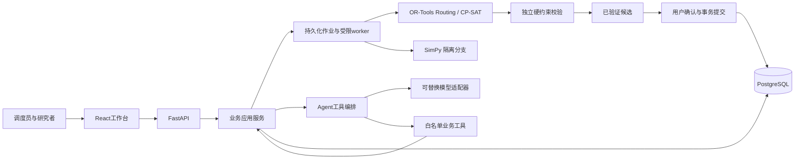
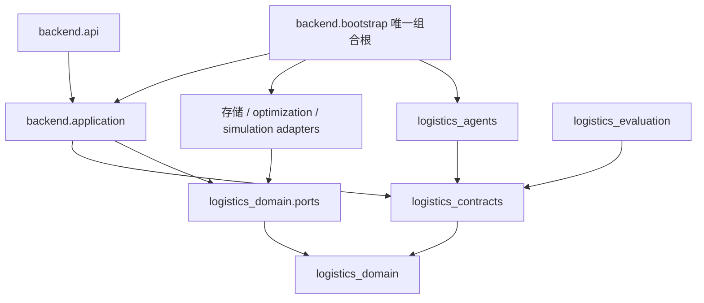

# AI Coding Master Plan

项目：**基于大模型技术的物流调度智能体应用开发**。冷链优先，保留通用物流能力。计划版本1.0.0，设计日期2026-09-12。规划入口：[AI-CODING-PLAN](AI-CODING-PLAN.md)；详细任务：[TASK_GRAPH](TASK_GRAPH.md)。

本轮仅生成开发Prompt系统，**不实现完整应用，不运行未来业务测试，不把现有骨架判为完成**。先行七项设计已写入[Architecture Overview](docs/architecture/ARCHITECTURE_OVERVIEW.md)。当前根目录无Git；`demo/`已有0.1.0协作骨架、生成契约和展示页面，文档标注业务适配器尚未实现。以上是本轮读取事实，不是重新执行全部旧工程测试的结果。

## 1. 项目目标

交付可复现的混合调度系统：自然语言或结构化需求→明确约束→OR-Tools运输/仓储求解→独立硬约束校验→版本化确认→SimPy推演→异常影响分析→局部重排→方案差异与指标比较。最终演示包含运输、仓运联合、车辆故障/取消/天气三个异常子场景。

输出执行方案必须具备车辆、订单、路线、到达、服务开始与结束、运输成本；仓储方案包含入库/出库/分拣/装车/卸货、资源占用和准备清洁任务。每次提交能追溯输入快照、约束、引擎配置、校验报告、确认者、事件、父版本与关键指标。

## 2. 非目标

MVP不包括复杂微服务、Kubernetes、消息队列集群、分布式数据库、复杂GIS、真实企业ERP/WMS/TMS全量集成、复杂RBAC、Blender高精度资产或3D游戏引擎。3D仅可选只读展示，核心Gate不依赖它。

运输MVP单车单趟、固定单车厢温控、订单不拆分、有限提送货；仓储有限资源、不可抢占作业、显式中断后剩余工作。多车厢、多趟任意补货、复杂跨国司机法规、任意多级中转、热力学冷链模型暂不支持；请求此类能力必须明确拒绝，不能默默弱化约束。精确道路/天气联网提供器可后增，离线合成矩阵始终可演示且清楚标明来源。

## 3. 架构原则

Contract First顺序固定：Domain Contract→Schema→Service Interface→Implementation→Test→Integration。共享ID/Enum/单位唯一；跨边界禁止未定义dict/Any；DTO、领域对象、ORM职责区分但不复制业务规则。API/Agent/Solver/SimPy/React不拥有重复规则。

LLM只理解、抽取、分解、选工具、调用工具、协调、解释。它不能自由生成正式调度、绕过Solver或直接写业务表。OR-Tools负责候选与确定性优化；独立validator重新检查硬约束，未覆盖的required规则fail closed。版本提交由应用服务原子完成。

不重设计整个架构，不为当前方便改公共接口；非阻断设计问题先登记`docs/architecture/issues/`。禁止TODO占位核心逻辑、fake implementation、hard-coded demo answer、吞Exception、只写代码不写测试、前后端各自维护枚举、React硬编码业务规则。测试替身只可用于测试，不得装配正式运行。

## 4. 系统上下文

用户是调度员/研究者（operator）和观察者（viewer）。调度员维护资源、提出请求、确认候选、注入仿真异常、运行实验；观察者查看授权范围内的方案和证据。外部依赖包括模型供应商、可选道路/天气数据源；PostgreSQL和worker属于系统自身。没有模型密钥时结构化规划、校验、仿真和模板解释仍可运行；自然语言能力明确显示不可用。

这是运行调用图，不表示相互导入；代码依赖图见下一节。用户确认是产品内调度提交流程，不是要求本轮规划每一步向用户重复询问。

## 5. 技术架构

一个Monorepo、一个后端应用、一个受限worker进程入口、一个PostgreSQL、一套React前端。建议uv workspace管理Python，npm workspace管理前端；Python3.12/Node22兼容基线继承现有资产，Phase01实际安装并精确锁依赖。选FastAPI、Pydantic、SQLAlchemy/Alembic、psycopg、OR-Tools、SimPy、React/TypeScript；不凭规划文档声称某个未经安装的最新小版本可用。

领域纯模型不依赖Pydantic/Web/ORM/模型SDK/OR-Tools/SimPy。包之间通过显式Protocol或DTO；实现对象只由bootstrap注入。公共类型的细节见[数据契约](docs/architecture/DATA_CONTRACTS.md)。

## 6. 模块划分

| 模块 | 软件交付物 | 所有权 |
| --- | --- | --- |
| domain/contracts | 32实体、辅助记录、Schema、Enum、ports、错误、导出 | A |
| backend | 应用用例、HTTP、PostgreSQL、worker、审计与组合根 | A |
| optimization.transport/matrix | 路径/容量/时间/温控/成本/矩阵与结果 | B |
| optimization.warehouse | 工序、资源、库存、setup、CP-SAT | A |
| optimization.validation/rescheduling | 跨域验证、影响闭包、冻结边界、局部求解、diff | A；B维护运输规则实现 |
| simulation | 时间推进、车辆/仓储演化、快照/分支；通用事件服务接口由A集成 | B |
| agents | 四角色、模型适配、白名单工具、有界编排、解释 | A |
| frontend | 11个工作台页面、客户端、实时视图 | A |
| evaluation | 14指标、实验基线、结果与统计 | A |

目标结构：`apps/backend`、`apps/frontend`、`packages/{domain,contracts,agents,optimization,simulation,evaluation}`；`data/{scenarios,seed,experiments}`；`tests/{unit,integration,solver,simulation,e2e}`；`docs/{architecture,api,algorithms,prompts}`。Python包使用`src/logistics_<name>`，避免与旧`app`命名碰撞。现有demo按P00/P01迁移映射分类复用；不从正式包导入教学demos或并行维护两个主契约。

## 7. 模块依赖图

交付链为：G00冻结→G01环境→G02领域→G03事务→G04数据→G05服务基础→G06/07运输→G08/09仓储→G10校验→G11/12仿真→G13事件→G14/15局部重排→G16优化/联合API→G17–23工具与Agent→G24–31交互→G32/33评估→G34集成→G35演示→G36性能→G37安全/运维→G38文档→G39发布。

这是默认严格阶段顺序，不能因任务技术上独立而跨过未通过Gate。阶段内允许任务DAG中的无依赖且写集合不冲突任务并行；本轮未指派新参与者或创建外部任务。每个Task的Dependencies、Blocks、Can Run In Parallel详见[TASK_GRAPH](TASK_GRAPH.md)，由机器清单生成、双向校验。

## 8. Domain Model

完整32实体逐项列出ID、状态、生命周期、关键字段、关联、created_at/updated_at继承规则，见[DOMAIN_CATALOG](docs/architecture/DOMAIN_CATALOG.md)。核心聚合：Order含Cargo；Warehouse包含温区/库位/月台/人员/设备；Schedule拥有不可变ScheduleVersion；稳定task_id映射每版本ScheduleTask；Event驱动ExceptionEvent→RescheduleRequest/Result→DecisionRecord；Simulation保存快照和事件分支；Experiment保存每策略每seed成功及失败结果。

任何新版本必须比较changed_tasks、added_cost、delay_difference、resource_changes、affected_orders、constraint_results。V1原始→V2故障→V3天气保留parent链，禁止UPDATE覆盖历史内容。执行事实与计划状态分离；在途取消不能删除实物位置或历史交付。

## 9. API Boundary

全部路径在[API_CONTRACT](docs/api/API_CONTRACT.md)；/api/v1结构化DTO、UUID、UTC、cursor分页、If-Match、Idempotency-Key、typed错误。耗时操作返回202 JobRef，查询result与确认候选分离。API不直接调用solver，不直接更新库存/计划。正式提交唯一入口ScheduleService，短事务检查最新revision、active版本、库存与资源占用并追加审计/outbox。

## 10. Agent Boundary

四角色Coordinator/Transport/Warehouse/Exception是有界应用角色，不要求四个常驻模型。所有业务能力经ToolExecutor→应用服务；白名单、权限交集、typed args、幂等和截止时间强制执行。Coordinator负责澄清与任务路由；专业角色负责调用对应工具与事实解释。默认最多12次工具、2轮修复、60秒共享预算。最终提交需要产品中明确用户确认及绑定candidate hash的令牌，模型文本不能授予权限。

SimulationAgent/EvaluationAgent可后增，但不能改变现有协议或成为MVP依赖。所有解释数字由工具事实引用；模型输出与事实不符时使用明确标注的确定性模板。

## 11. Solver Boundary

TransportSolver、WarehouseScheduler、RescheduleSolver、ConstraintValidator接口在Phase00冻结、按相应阶段实施。输入不可变快照和预算，输出typed候选/状态/诊断，禁止查库或提交。Routing处理路线/运力/硬窗，CP-SAT处理仓储资源与顺序准备，局部重排冻结不可逆前缀。具体变量、约束、目标、配置、结果和验证见[OPTIMIZATION_CONTRACT](docs/algorithms/OPTIMIZATION_CONTRACT.md)。

FEASIBLE、OPTIMAL、UNKNOWN、INFEASIBLE、TIMEOUT区分；无incumbent不得返回成功空路线。仓运子解分别可行不代表联合可行；Phase16有限反馈并跑完整validator。候选受搜索范围限制时诊断不能声称原始全局问题无解。

## 12. Simulation Boundary

SimPy负责时间与离散事件，DigitalTwinEngine负责纯投影，ScenarioEngine负责场景数据，EventEngine负责typed事件。正式事实与仿真分支隔离；相同时间事件确定排序，快照保存完整队列/RNG/剩余工作，恢复重建Environment，不pickle活跃generator。详细见[SIMULATION_CONTRACT](docs/algorithms/SIMULATION_CONTRACT.md)。

## 13. 数据库边界

PostgreSQL是正式状态、版本、事件、作业、审计唯一持久源。关系/并发键用表与FK/CHECK，不全塞JSONB；JSONB只存有schema_version的明确嵌套结构。REPEATABLE READ捕获快照；提交按固定资源顺序行锁与CAS，事务追加版本/预留/库存承诺/审计/outbox。Job有lease_epoch防旧worker写回，消费者容忍至少一次事件交付。真实PostgreSQL完成并发与回滚验收，SQLite不能代替。

## 14. 前端边界

11入口必须最终可用：Dashboard、Orders、Vehicles、Warehouses、Transport Scheduling、Warehouse Scheduling、Simulation、Exceptions、Agent Chat、Metrics、Experiments。React仅交互和展示，格式检查不代替领域检查；客户端从OpenAPI生成；以HTTP视图为准，先轮询后WebSocket。支持loading/empty/error/stale/cancelled状态、键盘使用、窄屏基本可用；地图不可用仍可读路线表，2D甘特为核心。

已有3D演示可复用视觉资产，但不带假数据接入正式模式；正式业务功能未实现页面不得伪造成功指标。

## 15. 测试策略

每任务包含Unit Test及Integration Test，算法任务增加Solver/Simulation Test，交互切片使用Vitest组件/网络边界测试，端到端使用Playwright真实API。关键断言由[T1/W1/J1/I1/S1/M1](docs/plan/TEST_FIXTURES.md)提供手算数据。小规模枚举oracle、单点破坏约束测试、事务竞争/崩溃恢复构成可信性核心。

纯测试替身只用于隔离接口；G07/G09/G10/G12/G15/G16及E2E必须真实OR-Tools/SimPy/PostgreSQL。真实LLM契约smoke独立证据，凭据缺失只能标未验收，不能以mock代替；可在本地结构化模式完成其他独立测试，但不得越过当前严格Gate。测试须精确报告选择范围；零测试、关键skip、失败或xpass/xfailed掩盖必需能力不能通过Gate。

## 16. Observability

trace_id贯穿HTTP→Job→AgentRun→ToolCall→Solver→Simulation→Event→ScheduleVersion；结构化日志含operation、status、duration、snapshot/candidate/version引用和错误码，敏感内容脱敏。Prometheus标签仅component/operation/outcome/solver_kind等有限集合，order_id/trace_id只入日志与trace。量测queue/build/solve/validate/persist与总耗时，记录原引擎状态、预算、随机种子、数据hash。

P05已建立trace、job状态与错误，不延到P37才考虑可观测性；P37补全OpenTelemetry、指标端点、审计查询和故障路径验证。API错误率/积压job/租约过期/验证拒绝是基本运维告警输入，阈值由实际基准记录。

## 17. Security

最小viewer/operator和对象scope从P05贯穿HTTP/Tool/WS；配置密钥只在后端，不进入前端、日志、场景或包。输入Schema、资源限额、超时、工具白名单、防prompt注入、HTML安全渲染、CSV安全转义为基础控制。SQL通过参数化ORM/driver，文件导出限定目录，CORS/WS Origin显式允许列表。

P37执行边界负例、依赖/密钥扫描、审计与备份恢复验收；不引入复杂安全平台。发现具体缺陷记录输入、影响文件、修复与回归证据，禁止吞异常或将拒绝包装为成功。

## 18. Demo Strategy

A：1仓2车8单，冷藏/冷冻分车的正常运输。B：2仓4车20单，完整入库/卸货/分拣/出库/装车与仓运反馈。C1：在途故障+明确救援交接；C2：装车前取消及在途取消分别运行；C3：天气矩阵换版。所有数据为可复现synthetic，参数与预期不变量见TEST_FIXTURES。

每个C子场景展示原方案、异常、影响范围、候选、新方案、六项diff和指标变化；保存事件/快照/配置/hash/实际求解结果。场景失败清楚展示诊断；不能用hard-coded demo answer替代真实求解。一键入口在P35生成，P39在干净目录重新执行。

## 19. Milestones

| 里程碑 | 出口Gate | 实际可展示能力 |
| --- | --- | --- |
| M0 契约与可运行底座 | G05 | 统一领域、持久化与基础服务；不声称调度完成 |
| M1 确定性调度核心 | G10 | 运输/仓储真实求解、独立完整校验 |
| M2 可推演和局部重排 | G16 | 仿真、事件、影响、局部解、联合API、版本提交 |
| M3 可信工具Agent | G23 | 四角色可控调用与解释、确认边界 |
| M4 工作台与评价 | G33 | 11入口、实时状态、14指标、对照实验 |
| M5 可复现演示 | G35 | A/B/C1/C2/C3真实完整证据 |
| M6 发布候选 | G39 | 性能/安全/恢复/文档/干净安装验收 |

不把40个Phase换算为40天，不保证首月做完整研究系统。优先完成依赖链上的核心正确性，选定里程碑交付；未通过Gate不以删验收项冒充完成。各阶段门槛详见[PHASE_GATES](docs/plan/PHASE_GATES.md)。

## 20. Definition of Done

单任务：所有依赖证据有效，唯一Objective完成，Scope内文件修改，接口无漂移，明确测试与命令实际执行通过，新增/修改文件与已知限制写Completion Report。不得用“已完成相关功能”等模糊结论；失败命令原样记录并修复后重跑相关检查。

单阶段：所有任务done、阶段业务断言全部通过、强制测试无关键skip、证据绑定代码revision/依赖hash/环境，原始日志和产物可检查；缺证据或仅文档静态检查不能通行。修改公共契约/实现使受影响Gate及下游证据失效，回到相应任务修复。

项目：G00–G39全部有效；全部正式方案经确定性求解与独立校验并版本化提交；A/B/C三类与C的三个子场景复现；14指标有口径与真实结果；真实LLM契约smoke和离线回退均有证据；干净环境安装/备份恢复/安全与性能基准完成。性能目标是待实测门槛：MVP20单4车2仓，单运输/仓储总求解预算5s、联合与重排15s；系统超时可明确失败但演示成功用例必须产出有效结果。HTTP作业接收p95<500ms、健康查询p95<200ms为固定参考机上的目标，G36记录实测，不把目标写为既成事实。

## 执行约定

从对应Prompt开始，读取列出的本地契约即可，不依赖历史聊天。`Current State`是前置理论状态，必须查证；本规划所有Task初始planned、Gate初始not_run。[规划校验报告](docs/plan/VERIFICATION_REPORT.md)仅检验本次交付的文档系统，不能替代上述业务Done。
