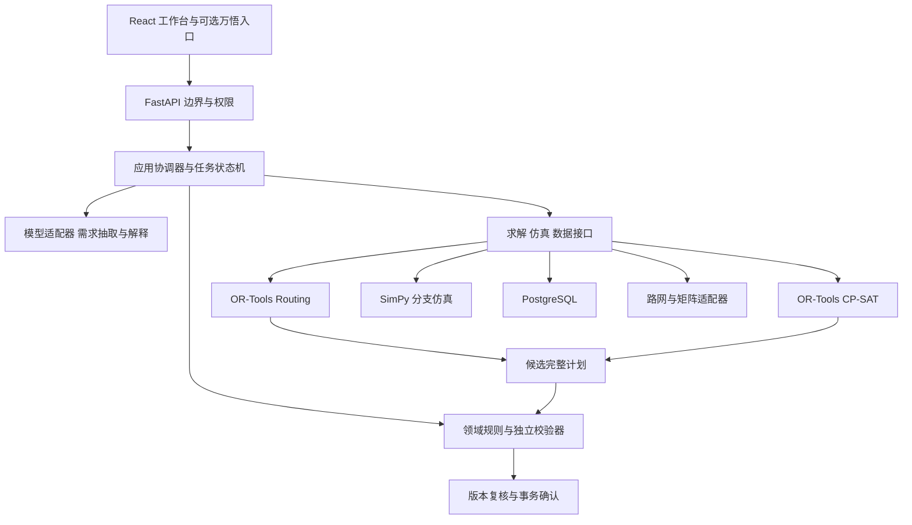

# 架构与求解设计

本设计选择模块化单体和少量可替换接口。以下流程与预算属于工程建议，尚未运行验证。技术事实与比较见 [开源调研](01-research.md)。

## 运行与依赖边界

这是调用流程图。代码依赖方向更严格：`api → application → domain`；`application → ports`；`adapters → ports + domain`。具体实现只由启动组合处装配，领域层不导入适配器。编排层不含模型 SDK、数据库查询或求解器变量。

| 模块 | 负责 | 边界验收 |
| --- | --- | --- |
| domain | 订单、资源、计划、事件、单位、状态迁移与独立校验 | 不启动数据库或模型就能验证一个计划 |
| application | 建计划、影响分析、仓运反馈、确认计划、四角色协商 | 替换假求解器即可跑用例；不重复实现硬约束 |
| ports | 约定少量能力输入输出 | 一个概念一个接口，不给每个表制造通用仓库层 |
| adapters | OR-Tools、SimPy、存储、模型、矩阵转换 | 引擎对象与第三方异常不透出边界 |
| api | 认证、输入检查、请求响应与作业查询 | 不能从 HTTP 路由直接调用求解器或改库存 |
| frontend | 工作台、来源、计划对比、确认和实验结果 | 只通过生成客户端访问后端，不连接模型或数据库 |

初期一个后端应用加 PostgreSQL。耗时求解使用有并发上限的独立工作进程，同仓库、同发布包，不建设微服务集群。作业持久化在数据库；领取有租约和心跳，进程崩溃可重领，结果按作业和版本幂等写入。不能只依靠一次 HTTP 请求内存中的后台任务。

四角色是有边界的应用模块，不等于四个持续互聊的大模型。只有协调入口和必要解释调用大模型；仓储、运输、异常角色主要调用确定性工具。新增框架必须能说明它解决了当前哪项难题。第一版不引入 Kafka、Kubernetes、独立向量库、分布式工作流或多套智能体框架。

## 求解职责

运输使用 RoutingModel：重量、体积分别建容量维度；时间维度包括等待、服务和行程；车辆允许集合约束温区与能力；有提送货时绑定同车与先后关系。单温区车辆按整条路线检查兼容，容量沿每条路线累计，不能只比较全局总量。第一版用班次上限，复杂驾驶休息制度另行建模。

仓储使用 CP-SAT：入库、预冷、分拣、出库对应作业区间与先后关系；月台等互斥资源用无重叠约束；人员、设备、库容用容量约束。具体求解接口参考 [Routing 指南](https://developers.google.com/optimization/routing) 与 [CP-SAT 指南](https://developers.google.com/optimization/cp/cp_solver)。

冷间存储区间从入库完成到出库开始，按数量占用容量，初始存量也进入时间轴。设备故障、清洁、温区切换产生不可用区间或容量下降；预冷同时消耗设备、时间与容量。批次相容性和冷间实际运行温区按整个重叠时段核查，不能仅判断“冷间能设置到这个温度”。

清洁准备时间不能只写成备注：相邻作业 i→j 的准备时长取规则表，显式约束 `start(j) ≥ end(i) + setup(i,j)`。有工人和设备需求的清洁本身是一项作业。序列相关准备以可选相邻关系编码；NoOverlap 本身不会自动补上清洁时间。

## 仓储运输联合方案

数据库快照固定订单、初始库存、车辆、资源日历和路网版本。跨模块交换 `ready_at`、接收时间窗、能力摘要和预留令牌，避免重复维护库存明细。

1. 根据温区、库存与节点能力筛掉不合格候选仓；每单最多保留 2 个候选节点，预算可配置。
2. 仓储模块给出带有效期的候选作业窗口和最早可装车时间，尚不占用正式资源。
3. 运输模块联合车辆、路线、仓节点候选给出到达/离开时间，不能只事先按最近仓固定分组。
4. 仓储模块基于真实到达时间排月台、分拣与冷间；反馈冲突时段、替代窗口或候选仓失效。
5. 协调器收紧允许窗口或切换候选分配，最多 3 轮且受全局时间预算约束；去重相同候选，避免震荡。所有轮次共同分享预算，不是每轮重新计时。
6. 独立校验整个订单链、车辆路线、存储和作业计划。只校验各子解不足以确认整体可行。
7. 在事务中复查快照版本、库存与资源预留，原子确认。任意失败返回过期或冲突状态。

候选节点选择可以用小规模分配问题与有限邻域搜索实现；不枚举所有订单的 2 的 n 次方组合。该分解法是研究设计，不保证找到所有存在的可行解或全局最优。受限候选集无解不能断言原始全局问题无解；记录范围，先扩候选，再做预算内全量规划。

初期真正完成“2 仓入出库联动”比一次支持任意多跳转运更关键。转运启用时增加有库存守恒的运输腿、源仓出库、目的仓入库和交接作业；不得瞬间修改仓库编号冒充转运。

## 异常与局部重排

识别采用规则与事件源；有信息缺口的自然语言异常进入待核实状态。影响集从故障车辆、道路、订单或资源出发，沿“订单—运输腿—仓储作业—共享资源时段”依赖扩展，直到跨界约束可验证。冻结已发生事实、已消耗资源和不可撤销装载；正常在执行且不可抢占的作业保持承诺。故障导致无法继续时，显式记录暂停/中断和已完成部分，再安排剩余作业，不能强行保留已经不可能实现的原结束时间。

在途车辆以事件时刻的实际/模拟位置、剩余载荷和剩余班次建立新起点，不能退回仓库重新满载出发。故障车上的货物若要换车，必须有救援到达、交接地点、耗时与温控限制；无此数据就输出待人工处理。取消在途订单也保留实物去向。

本轮不可行或超时：局部扩展 → 扩大搜索时域/影响集 → 全量未执行部分重排。扩大搜索时域只改变考虑哪些未执行任务和资源日历，不改变订单允许的硬时间窗。硬约束不自动放松。旧方案必须先在新状态下重新校验，仍安全的部分可继续；受影响且不再可行的任务暂停。不能以“保留上次方案”为由继续驶向已故障冷库。

局部目标在满足硬约束后，先降低允许暂缓订单的未服务数量，再比较软期望时间的延误、成本和扰动。必服务订单不能靠罚分丢弃；只有场景明确允许暂缓的订单才能列为未服务。硬时间窗与软期望时间分字段表示，延误罚分不能购买突破硬截止时间的资格。扰动包含改派车辆、改仓、作业开始时间变化和路线顺序变化；量纲、权重和规则版本随结果保存。阶段式目标共享总预算，前一阶段未证明最优时也如实记录，不宣称词典序全局最优。

## 合同网与一致性

逻辑消息链：发布任务 → 仓储/运输角色给候选报价 → 协调角色组合验证 → 临时预留 → 统一确认或撤销。单次默认至多 2 轮报价；所有消息有任务号、截止时间、快照版本、相关事件和幂等键。报价不是最终资源承诺。

一次确认在同一 PostgreSQL 事务内完成库存与时段预留，使用版本号、约束与适当行锁防止双订。过期报价不得授标。两个调度请求同时争用最后一个月台时，只允许一个确认；另一个收到冲突并重新规划。

单进程的四角色架构只证明接口和信息视图可以分离。仓储角色仅返回汇总能力、窗口和约束原因；服务层访问控制阻止协调入口读取其他节点的客户、价格或库存明细。尚不声称已解决真实跨组织分布式一致性与商业隐私。

## 可控延迟与降级

矩阵在调用求解器前批量取得并缓存；键包含坐标/节点顺序、路网版本、车辆配置与时间段。求解回调内不查数据库或网络。天气事件生成新的矩阵版本；离线模式使用明确标注的固定矩阵，不用直线距离冒充真实道路行程。

时间预算、工作线程数、并发作业数和重试轮数都可配置。CPU 密集工作不能阻塞 API；避免多个求解作业各占满所有 CPU。提交作业后前端查询状态，初期使用轮询即可。

模型不可用时，结构化表单、确定性规划、事件注入和模板解释仍工作；自由语言入口明确提示不可用。求解失败时保留诊断；地图失败时展示节点示意、里程表和甘特图。万悟失联时可继续独立原型演示，但不把本地回放当作平台联调已验收。
