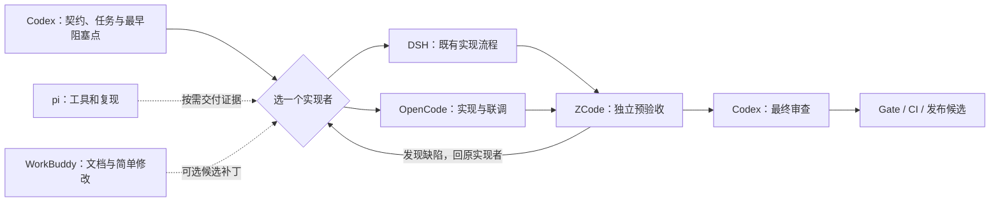

# 长期项目 Agent 开发链与可执行提示词

**2026-10-01 返工后执行入口：**先读根 [AGENTS.md](../../AGENTS.md)与[完整派发清单](12-project-completion-dispatch.md)。P01-02 限定返工已 READY_FOR_ZCODE 并停止；按 N01–N05 解阻 G00、刷新交接、重验 Phase 01、审查 G01，再走余下 103 个任务。G01 尚未有效签收；下面 2026-09-18 的工具链版本是历史快照，不能据此自动升级或启动下游业务阶段。

调研日期：2026-09-18。适用环境：Windows / PowerShell；当前项目为 `D:\Agent\DeepSeekHarness\IntelligentLogisticsDispatchingAgent`。迁移到其他项目时替换项目根目录，并重新盘点。本次交付是方案和提示词，未安装插件、升级 DSH、修改业务代码或签收 Gate。

## 建议采用的主流程

保留本项目已经使用的 **Codex 规划与解阻 → DSH 实现 → ZCode 独立预验收 → Codex 最终审查 → 项目 Gate/CI**。OpenCode 是另一条实现通道，也可承担前端联调；同一个任务只指定 DSH 或 OpenCode 中的一个主写者。pi 承担小工具、复现脚本和独立诊断。WorkBuddy 仅领取可丢弃、可复核的零散任务，不进入主流程依赖。

对没有这套历史治理的新项目，默认采用更短的 **Codex 规划/审查 + OpenCode 或 DSH 实现 + CI**，只有复杂或高风险任务增加独立预验收。大型项目需要稳定的任务契约、版本和证据，不需要每个小任务都经过六个工具。

## 按架构和本项目需求分工

下表是投入优先级和角色建议，**不是经过同模型、同预算实测的能力排行榜**。Agent 的表现取决于模型、推理预算、工具权限、上下文和任务类型；仅根据产品名称无法证明谁编码最强。真实比较使用 `09-maintenance-and-benchmark.md`。

| 工具 | 主流程定位 | 架构与扩展方式 | 本项目建议 |
| --- | --- | --- | --- |
| Codex | 第一优先：架构裁决、难题、最终审查 | Skills、MCP、插件、受控工具和任务环境；桌面与 CLI 能力需分别检查 | 集中处理跨模块契约、事务、Gate、复杂前端和集成；避免既做实现又把自己当独立审查者 |
| OpenCode | 第一优先：通用实现平台与备用实现通道 | 多模型供应商、原生 agent/skills/LSP/MCP，加 JS/TS 插件；有较丰富的社区生态 | 先用原生能力与少量插件，适合日常实现及前端验证；账户可用模型决定实际能力 |
| DSH | 本项目保留为主要实现者；平台升级单独验证 | Cordis 插件树；模型、工具、会话等均可组合 | 沿用已有交接路径；仍为 developer preview，不能把快速迭代等同于生产稳定 |
| ZCode | 独立预验收与缺陷复现 | 自有插件清单，支持 skills/commands/agents/hooks/MCP；有 Claude 插件清单兼容入口 | 核对实际加载组件；兼容清单不代表所有 hooks、命令和权限语义兼容 |
| pi | 轻量工具与可编程执行入口 | 终端 harness、TypeScript extensions、skills、prompt templates、npm/Git packages、RPC | 保持小而可控；官方设计未内置 MCP 与子 agent，扩展接入需另验 |
| WorkBuddy | 可选杂活 | 使用本机已提供的能力；无需为此引入复杂插件链 | 文档排版、文案、简单页面、样例整理；没有免费额度时直接跳过 |

架构来源：[Codex 插件](https://learn.chatgpt.com/docs/plugins)、[OpenCode 插件](https://opencode.ai/docs/plugins/)、[DSH](https://github.com/deepseek-ai/deepseek-harness)、[ZCode 插件](https://zcode.z.ai/cn/docs/plugin)、[pi](https://github.com/earendil-works/pi/tree/main/packages/coding-agent)。以上角色划分是针对本项目的判断。

## 本机检查得到的事实

| 项目 | 2026-09-18 观察 | 对方案的影响 |
| --- | --- | --- |
| OpenCode | 全局 npm 包 `opencode-ai 1.18.25` | 先验证该版本对应插件 API，不直接照抄新版文档 |
| Codex CLI | 全局 npm 包 `@openai/codex 0.154.0` | 不代表当前桌面应用版本；分别盘点 |
| pi | `@earendil-works/pi-coding-agent 0.85.1`，要求 Node ≥22.19.0 | 不再照旧教程盲装旧包名 |
| Node | `v24.18.0` | 满足已查 Context7、Playwright MCP、pi 的最低版本；完整兼容还要实测 |
| OCX / Bun | 全局包 `ocx 2.0.15`、`bun 1.4.2` | 已有隔离配置工具，优先复用；不等于 profile 已初始化或隔离已通过 |
| OpenCode 配置 | 同时有 `opencode.json` 与 `.jsonc`；后者声明浏览器桥接、quota、pilot | 检查实际合并结果，不能仅按文件名猜覆盖优先级 |
| OpenCode pilot | 配置为 `@lesquel/opencode-pilot@latest`；配置目录实际包 `1.23.1` | 它是远程控制插件，不能当作编码编排器；固定经过验证的版本 |
| OpenCode 插件 SDK | 配置目录安装 `@opencode-ai/plugin 1.18.30` | 与主程序版本有差异，只是待验证项，尚未证明不兼容 |
| DSH | 两处 npx 缓存中发现 `@deepseek-ai/dsh 0.1.0-rc.7`；未发现全局 dsh 命令 | 缓存版本不证明当前运行进程版本；先查真实启动入口，不能只跑全局升级 |
| DSH 用户数据 | `C:\Users\30382\.dsh`；web profile 有 12 项依赖声明 | 升级需保留会话、存储、附件、凭据与 profile，并验证第三方插件 |
| pi 扩展 | 用户 settings 未声明 packages/extensions/skills 字段 | 不能因此断言所有自动发现目录都无插件 |
| 项目 | 当前根目录不是 Git 仓库；记录中 G01 为 failed | worktree/PR 流程要先核对真实仓库与基线；不能虚构 commit |
| 项目文档 | 根 README 指向旧 `demo/`，现有任务/交接已使用 `apps/`、`packages/` | 先依据迁移记录和任务清单确认当前执行根目录，处理文档漂移 |

本地证据来自项目 `package.json`、`pyproject.toml`、`OWNERSHIP.json`、`artifacts/gates/G01.json`、`docs/handoffs/P05-03/`，以及上述用户目录中的包清单和选择性配置字段。未读取凭据文件正文，未执行本项目测试；Gate 状态为已有记录，未在本轮重新签收。

## 插件选择：先补能力缺口，再加框架

版本均为查询时的候选快照，日期为 UTC 发布日期；**不是已经在本机测试通过的安装锁**。执行提示词时重新查官方来源，测试后才把精确版本写入运行清单。

| 优先级 | 插件/能力 | 候选版本与发布情况 | 用途与取舍 |
| --- | --- | --- | --- |
| 优先补齐 | [Context7](https://github.com/upstash/context7) | `@upstash/context7-mcp 4.1.1`，09-14；近期 09-08/09/11/14 均有发布 | 查 FastAPI、React、SQLAlchemy 等对应版本文档；MCP 或 CLI+Skills 选一条，先确认现有等效能力 |
| 优先补齐 | [Playwright MCP](https://github.com/microsoft/playwright-mcp) | `@playwright/mcp 0.0.81`，09-14；上一正式编号 0.0.80 在 09-01 | 浏览器交互、页面和错误复现。项目的 `@playwright/test 1.63.0` 是测试依赖，和 MCP 不共用版本号；已有浏览器工具能完成验收时不重复安装 |
| 有需求时 | [Plannotator](https://github.com/backnotprop/plannotator) | `@plannotator/opencode 0.27.16`，09-18；近期 09-10/11/15/18 发布 | 可视化审阅计划和 diff。刚发布的版本先做候选验证，不直接覆盖稳定环境 |
| 跨项目值得评估 | [Superpowers](https://github.com/obra/superpowers) | 选择官方 tag/commit；本轮未成功核实最新 release 编号 | 可复用调试、计划、验证技能。此项目已有 109 个任务提示词和 Gate，优先按需选技能；避免再覆盖整套任务治理 |
| 保留并验证 | [OCX](https://github.com/kdcokenny/ocx) | 本机 `2.0.15`；本轮未核实最新版本 | 创建稳定/试验 profile；配置隔离不等于操作系统沙箱，须检查全局配置是否仍被合并 |
| 仓库接通后 | [GitHub 官方 MCP](https://github.com/github/github-mcp-server) | 执行时选择官方支持版本或远程服务 | PR、issue、CI 信息；已有 Codex GitHub 连接能完成工作时复用。远程服务版本通常无法由客户端锁定 |
| 试验环境可选 | [Oh My OpenCode / Oh My OpenAgent](https://github.com/code-yeongyu/oh-my-openagent) | npm `oh-my-opencode`：latest `4.19.4`（08-01），beta `5.0.0-beta.75`（09-18） | 重型编排包，活跃开发主要在新 beta 线。仅在隔离 profile 对照测试，不把 beta 当稳定版，不与其他自治编排循环同时接管同一任务 |
| 现有保留 | [opencode-pilot](https://github.com/lesquel/open-remote-control) | `1.23.1`（08-24） | 远程监控和操作；与编码质量没有直接关系，按真实远程需求保留 |
| 观察名单 | [DCP](https://github.com/Opencode-DCP/opencode-dynamic-context-pruning) | README 明确开发放缓，新的上下文功能优先转移到 Sleev | 不符合你当前“更新频繁”的首选条件；先用原生压缩和交接文件。已有安装也不能无验证删除 |

OpenCode 的[生态页](https://opencode.ai/docs/ecosystem/)列出的是社区项目，并不代表官方对每个插件作稳定性背书。上表更新频率来自 npm 元数据，不以 stars 或总提交数替代稳定性证据。包元数据来源见 `versions-snapshot.json`。

推荐先落地：**原生 Skills/LSP + 文档查询 + 一个浏览器通道 + 已有的 OCX 隔离能力**。之后按需要加 Plannotator 或 Superpowers 的特定技能。全套编排、第二套记忆系统、多个浏览器控制器、认证替代插件不属于基础必装集。

DSH 已有 memory、agent-teams、搜索、视觉、浏览器、computer-use、移动访问和市场插件声明。优先检验现有插件是否真正可用，暂不增加同类。Codex 本会话已提供 OpenAI Docs、浏览器/Chrome、Codex Security 等能力，也先复用。

## DSH 升级的具体判断

缓存基线是 `0.1.0-rc.7`；查询时 `@deepseek-ai/dsh` 的 latest/next 都是 **`0.1.5-rc.2`**，alpha 为 `0.1.6-alpha.2`。注册表未发现不含预发布后缀的版本，官方也标为 developer preview。因此本次推荐目标叫“默认发布通道候选”，不能称作正式稳定版。

特别注意：`@deepseek-ai/dsh-mcp-client` 的 latest 仍指向 **`0.0.1-rc.1`**，next 才是 `0.1.5-rc.2`。该目标版本的 peerDependencies 要求对应的 DSH 组件范围与 Cordis `^4.0.2`。必须按依赖图选择版本，不能对所有包统一追加 `@latest`，也不能仅因版本号相同就判定兼容。

升级提示词会先用隔离的 `DSH_HOME`、数据副本和端口验证，再切换原有启动入口；回滚同时恢复旧程序、profile/锁和兼容的数据副本。**本轮没有执行升级。**

## 提示词使用顺序

每份文件都是交给对应 agent 的任务提示词；该 agent 需要能读取本目录。迁移到另一台机器时可复制整个目录。共同规则在 `00-common.md`，所有执行提示词均要求先读它。

| 顺序 | 文件 | 交给谁 | 结果 |
| --- | --- | --- | --- |
| 1 | [01-codex-control-and-setup.md](01-codex-control-and-setup.md) | Codex | 盘点、能力去重、最早阻塞点、必要 Codex 配置 |
| 2 | [03-dsh-upgrade.md](03-dsh-upgrade.md) | Codex 或不依赖当前 DSH 进程的 agent | 备份、隔离升级、插件兼容矩阵、切换与回滚证据 |
| 3 | [02-opencode-setup.md](02-opencode-setup.md) | OpenCode | 稳定/试验 profile，文档与浏览器能力，固定版本 |
| 4 | [05-zcode-precheck.md](05-zcode-precheck.md) | ZCode | 初次配置并按任务独立预验收 |
| 5 | [04-dsh-development.md](04-dsh-development.md) | DSH | 单个可执行任务的实现和证据 |
| 按需 | [06-pi-setup-and-tools.md](06-pi-setup-and-tools.md) | pi | 轻量环境、复现与工具任务 |
| 按需 | [07-workbuddy-small-tasks.md](07-workbuddy-small-tasks.md) | WorkBuddy | 限定零散任务与候选补丁 |
| 每个关键交付 | [08-codex-final-review.md](08-codex-final-review.md) | Codex 新审查会话 | 独立结论和合法 Gate 证据 |
| 每次开工 | [10-daily-dispatch.md](10-daily-dispatch.md) | Codex | 一张可执行任务卡与正确实现通道 |
| 定期手动运行 | [09-maintenance-and-benchmark.md](09-maintenance-and-benchmark.md) | Codex | 更新候选、兼容测试和实际能力比较 |

环境准备完成后，日常只需“调度 → 一个实现者 → 预验收/审查 → Gate”。WorkBuddy 和 pi 都是可选支援。本次没有创建定时任务。

## 稳定性接受条件

1. 准确识别宿主、配置作用域、模型路由和安装来源；配置已声明、包已安装、运行已加载、功能已验证分别记录。
2. 本地包固定精确版本或提交，保留传递依赖锁；官方托管 MCP 记录服务地址、协议和验收时间，不声称能锁住服务端。
3. 新版本通过冷启动、工具调用、取消/超时、会话恢复和回滚验证后晋级；可选插件失败时仍能通过 CLI/文档完成任务。
4. 一项业务任务同一时刻只有一个主写者；审查绑定同一 revision/内容快照，修复后旧结论失效。
5. 首次出现缺失前置就返回最早阻塞节点，生成一个修复任务；不继续分发一串必然失败的下游任务。
6. 发布频繁仅意味着候选更新多；以项目真实回归、兼容声明、维护响应和可恢复性判断可用性。
