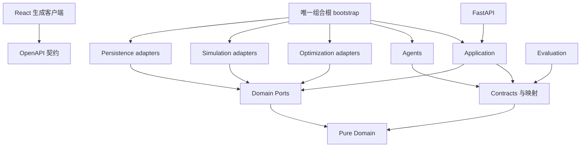

# AI-CODING-PLAN · 生成详细 Prompt 前的架构总览

日期：2026-09-12。本文先于详细 Prompt 生成；设计基线为本次用户完整需求。当前交付是开发规划，不是已实现功能或已通过业务验收的声明。

## 1. Architecture Overview

采用模块化单体：React → FastAPI → 应用服务 → 显式 Protocol → OR-Tools / SimPy / PostgreSQL / LLM 适配器。LLM 理解、分解、调用工具和解释；运输 Routing 与仓储 CP-SAT 产生候选；独立 ConstraintValidator 重新检查全部硬约束；提交服务基于最新快照原子确认 ScheduleVersion。Agent、求解器、仿真不得直接修改正式计划。数字孪生运行在隔离分支，正式状态只能由应用服务提交。

## 2. Module Map

| 路径（目标结构） | 职责 | 禁止依赖 / 行为 |
| --- | --- | --- |
| apps/backend | HTTP、应用用例、存储适配、组合根、受限 worker | 路由直接运行求解 / 业务状态绕过用例更新 |
| apps/frontend | 11 个工作台入口、生成客户端、2D 路线与甘特图 | 维护第二套枚举或调度规则 |
| packages/domain | 纯领域实体、枚举、规则、状态机、ports | Web、ORM、Pydantic、模型 SDK、OR-Tools、SimPy |
| packages/contracts | Pydantic 边界 DTO、领域映射、schema 导出 | 数据库与业务执行 |
| packages/optimization | TransportSolver、WarehouseScheduler、RescheduleSolver、独立校验 | 查库、联网、修改正式方案 |
| packages/simulation | DigitalTwinEngine、SimulationEngine、EventEngine、ScenarioEngine | 把推演结果当正式事实 |
| packages/agents | Coordinator / Transport / Warehouse / Exception 四角色 | SQL、仓储库直写、自由生成最终调度 |
| packages/evaluation | 指标定义、实验和对照策略 | 修改主业务数据、隐藏失败样本 |

`domain/ports` 使用纯 typed domain models；`contracts` 是边界序列化模型且映射领域对象，禁止复制业务规则。领域 ID / Enum 由 domain 唯一定义，前端由 OpenAPI 派生。

## 3. Dependency Graph

下面是代码依赖图，箭头表示“导入 / 依赖”，不是运行消息方向。



## 4. Phase Plan

00 冻结 → 01 工程 → 02 领域 → 03 数据库 → 04 数据 → 05 基础 API → 06 运输契约 → 07 运输求解 → 08 仓储契约 → 09 仓储求解 → 10 联合硬约束校验 → 11 仿真契约 → 12 SimPy → 13 事件 → 14 影响分析 → 15 局部重排 → 16 优化与联合调度 API → 17 工具协议 → 18 模型适配 → 19–22 四角色 → 23 编排 → 24–30 UI → 31 WebSocket → 32 指标 → 33 实验 → 34 集成 → 35 三类 Demo → 36 性能 → 37 安全审计 → 38 文档 → 39 发布。

阶段编号保持用户顺序。G00–G39 是严格阶段屏障：前一个 Gate 未通过，禁止进入后一个阶段。阶段内依赖按 TASK_GRAPH；允许的并行集合必须同时满足前置任务完成且写文件不冲突。不得为并行跳过 Gate。40 个阶段是工程分解，不宣称等于 40 天。

## 5. Prompt Tree

```text
docs/prompts/
  00-master/             Phase 00
  01-foundation/         Phase 01、04
  02-domain/             Phase 02
  03-database/           Phase 03
  04-api/                Phase 05、16
  05-transport-solver/   Phase 06–07
  06-warehouse-solver/   Phase 08–10
  07-simulation/         Phase 11–13
  08-exception/          Phase 14–15
  09-agents/             Phase 17–23
  10-frontend/           Phase 24–31
  11-evaluation/         Phase 32–33
  12-integration/        Phase 34–37
  13-release/            Phase 38–39
```

文件编号一律 `P{phase:02d}-{task:02d}-{slug}.md`，以阶段为准，不按目录编号解释。每个任务是一个唯一目标、一组精确接口、一组确定验收数据及单位测试 / 集成测试；算法任务另有求解 / 仿真测试。

## 6. Major Technical Risks

| 风险 | 强制控制 | 最迟 Gate |
| --- | --- | --- |
| 仓储与运输单独可行但联合不可执行 | 有限轮次窗口反馈 + 全链校验 + 原子预留 | G16 |
| 车辆故障使在途货物瞬移 | 事件时刻位置、剩余载荷、救援交接任务与不可逆前缀 | G15 |
| 两个计划抢占同一库存 / 月台 | 固定快照、资源锁、版本 CAS、幂等与事务回滚 | G03、G16 |
| 超时被写为无解，启发式被写为全局最优 | 原始引擎状态和标准状态分存；有无可行 incumbent 分开 | G07、G09 |
| 仿真被误当现实、回放产生新随机轨迹 | 分支隔离、显式 RNG 状态、稳定事件排序、边界快照恢复 | G12 |
| 旧 demo 的单位、接口与新结构混用 | 迁移清单、v0.1 → v1 显式转换、禁止直接导入教学探针 | G01、G02 |
| LLM 工具误用 / 注入 / 越权提交 | 白名单、typed args、服务权限、确认令牌、调用预算 | G17、G23 |
| 规划量超过首月能力 | 按可验收里程碑交付；未完成范围保持显式未实现 | 各 Gate |

## 7. 推荐调整项（本计划采用）

1. 在 Phase 00 冻结 ConstraintValidator Protocol，Phase 02 固定违规代码；Phase 07/09 已有各自结果检查，Phase 10 才汇总联合验证。正式提交只能在 G10 之后启用。
2. 在 Phase 03/05 建持久化 Job / Idempotency / Outbox，Phase 16 接线耗时求解；CPU 工作进入受限独立进程，API 不等待完整求解。
3. 加入 `packages/domain`、`packages/contracts` 两个共享包，解决后续 Agent / API / Solver / Simulation 的类型唯一来源问题。
4. 运输 MVP：单次行程、单车厢固定温控、订单不可拆分、可选提送货；仓储 MVP：有限资源和有向无环工序；联合调度不宣称全局最优。所有未支持输入显式拒绝。
5. 当前根目录无 Git；已有 `demo/` 是 v0.1 骨架与展示资产。新计划目标为根级 monorepo，未来 P01 记录迁移映射，保留 demo 只读基线；本轮不迁移、不更新 Linear、不覆盖既有业务文件。
6. A/B 分工继续映射：B 运输 / 矩阵 / 仿真；A 其余及共享契约与前端。计划不替代已经存在的实时工作状态。
7. 2D 展示完成后，已有 3D 可独立接只读视图；不进入核心 Gate，也不成为调度服务的依赖。

接续阅读：[Master Plan](../../PROJECT_MASTER_PLAN.md)、[Task Graph](../../TASK_GRAPH.md)、[Prompt 索引](../prompts/README.md)。
