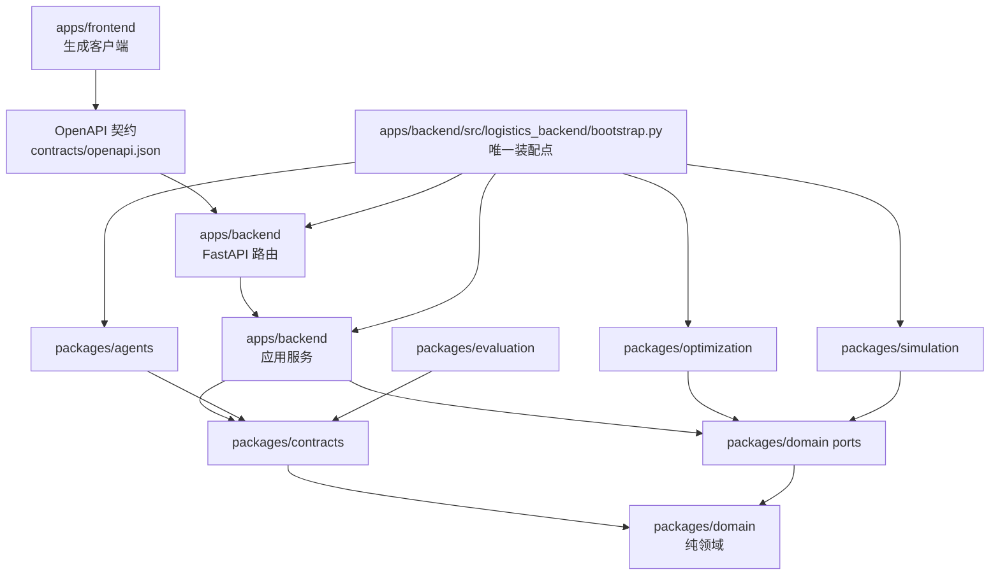

# 旧 demo 到目标 monorepo 的迁移映射（P00-01）

本文是旧 `demo/` 与 v1 目标目录之间的权威映射：每个旧文件对应哪个新路径、由哪个未来任务负责、以及 v0.1 到 v1 的转换差异登记。旧基线 `demo/` 保持只读留存，映射表是唯一权威，不存在第二份以文件形式并行维护的目标契约；写入 `contracts/` 的 OpenAPI 与类型 JSON Schema 都是生成物，`docs/architecture/BASELINE_INVENTORY.json` 保持只读，由其生成器重建。

本文只登记映射与差异，不声明任何任务已完成。第 2 节出现的每个目标路径都属于未来任务的目标，在对应任务实际交付前均不存在。

## 1. 目标依赖方向

目标结构为模块化单体：`apps/frontend`（生成客户端）→ OpenAPI 契约；`apps/backend` → 应用服务 → `packages/contracts` 与 `packages/domain` 的 ports；`packages/contracts` → `packages/domain`；`packages/agents` → `packages/contracts`；`packages/optimization` 与 `packages/simulation` → `packages/domain` 的 ports；`packages/evaluation` → `packages/contracts`。整个系统只有一个组合根 `apps/backend/src/logistics_backend/bootstrap.py`。

箭头表示“导入 / 依赖”，不是运行消息方向。约束：

- **唯一装配点**：只有 `apps/backend/src/logistics_backend/bootstrap.py` 实例化数据库 adapter、solver、SimPy 引擎与 LLMProvider，并注入应用服务；路由层不得构造 solver，未完成能力在注册表显式 disabled，不得装配 fake 成功 adapter。
- **adapter 内的第三方引擎对象不得穿出边界**：OR-Tools、CP-SAT、SimPy、OSRM、ORM Session 与模型 SDK 的对象只能存在于对应 adapter 内部，跨边界只传递 `packages/contracts` 中的边界 DTO 或 `packages/domain` 中的纯 typed domain models 与 Protocol。
- `packages/domain` 不导入 Web 框架、ORM、Pydantic、模型 SDK、OR-Tools 与 SimPy；`packages/contracts` 不承载数据库与业务执行；`apps/frontend` 不维护第二套枚举或调度规则。

## 2. 旧到新的映射表

表内 `disposition` 与 `docs/architecture/BASELINE_INVENTORY.json` 的 `entries` 字段一致；`对应任务` 为该路径的**未来**负责任务，不代表已完成。

### 2.1 基线记账与协作文档

| 旧路径 | owner | disposition | 目标路径（未来） | 对应任务 |
| --- | --- | --- | --- | --- |
| `demo/README.md` | A | reference | `demo/README.md`（原地只读留存） | — 不迁移 |
| `demo/FILE_MAP.md` | A | reference | `demo/FILE_MAP.md`（原地只读留存） | — 不迁移 |
| `demo/DEV_LOG.md` | A | reference | `demo/DEV_LOG.md`（原地只读留存） | — 不迁移 |
| `demo/AGENTS.md` | A | reference | `docs/implementation/P00-01.md` | P00-01 |
| `demo/docs/` | A | reference | — 不迁移（由 `docs/{architecture,api,algorithms,prompts}` 替代） | P38-01、P38-02 |
| `demo/OWNERSHIP.json` | A | adapt | `OWNERSHIP.json` + `scripts/check_ownership.py` | P01-03 |
| `demo/scripts/build_file_map.py` | A | adapt | `scripts/check_ownership.py` | P01-03 |
| `demo/scripts/check_project.py` | A | adapt | `scripts/check_architecture.py`、`scripts/gates.py` | P01-02 |
| `demo/.github/workflows/checks.yml` | A | adapt | `.github/workflows/ci.yml` | P01-02 |
| `demo/scripts/export_contracts.py` | A | reuse | `scripts/export_contracts.py` | P02-04 |
| `demo/deploy/compose.yaml`、`demo/deploy/README.md` | A | reference | — 不迁移（由新部署目录重写） | P39-01 |
| `demo/reference_demos/**`（9 个文件） | A | reference | — 不迁移（永久禁止导入） | — |
| `demo/frontend/node_modules/`（10984 个文件） | A | reference | — 不迁移（构建产物，由 `package-lock.json` 与 `npm ci` 重建） | — |
| `demo/.venv/`（1476 个文件） | A | reference | — 不迁移（由 `uv.lock` 与 `uv sync` 重建） | — |
| `demo/platform/wanwu/README.md` | A | reference | — 不迁移（旧平台适配资产，无 v1 对应能力） | — |
| `demo/docs/**`（15 个文件） | A | reference | — 不迁移（由新 `docs/` 结构取代） | P38-01 |
| 其余 `reference` 条目（包 marker、`requirements*.txt`、`dist/` 产物、占位说明等） | A | reference | — 不迁移（只读留存） | — |

基线清单的冻结边界分两类登记（见 `docs/architecture/BASELINE_INVENTORY.json` 的 `entries` 与 `coverage.boundary_directories`）：上述逐文件条目全部带真实 `sha256` 与 `target_path=null`；两个大型派生目录 `demo/frontend/node_modules/` 与 `demo/.venv/` 只记录文件计数与树指纹，不逐文件写入 `entries`。此外，打包交付物 `demo.zip`、`demo.zip.sha256` 位于仓库根目录而非 `demo/` 子树，因此由 `artifacts/handoffs/P01-01/dsh/evidence.json` 记录其哈希，清单不再包含该条目。

### 2.2 契约与样例

| 旧路径 | owner | disposition | 目标路径（未来） | 对应任务 |
| --- | --- | --- | --- | --- |
| `demo/contracts/VERSION` | A | adapt | `packages/contracts/src/logistics_contracts/__init__.py` | P01-03 |
| `demo/contracts/README.md` | A | adapt | `packages/contracts/src/logistics_contracts/__init__.py`（索引内容登记于本文） | P01-03 |
| `demo/contracts/changes/TEMPLATE.md` | A | adapt | `contracts/changes/README.md` | P01-03 |
| `demo/contracts/openapi.json` | A | rewrite | `contracts/openapi.json`（由已实现 router 导出，禁止手改） | P05-01 |
| `demo/contracts/schemas.json` | A | rewrite | `contracts/schemas.json`（由导出脚本生成，禁止手改） | P02-04 |
| `demo/contracts/examples/dispatch_request.json` | A | adapt | `packages/contracts/src/logistics_contracts/__init__.py` | P02-03 |
| `demo/contracts/examples/scenario_import_request.json` | A | adapt | `packages/contracts/src/logistics_contracts/__init__.py`（样例由 `data/scenarios/` fixture 替代） | P04-01 |
| `demo/contracts/examples/event_departure_delayed.json` | A | adapt | `packages/simulation/src/logistics_simulation/__init__.py` | P13-01 |
| `demo/contracts/examples/routing_request.json` | A | reuse | `packages/optimization/src/logistics_optimization/__init__.py` | P06-01 |
| `demo/contracts/examples/routing_result_not_implemented.json` | A | reference | — 不迁移（作为 v0.1 无求解证据留存） | — |
| `demo/backend/app/contracts/__init__.py` | A | rewrite | `packages/contracts/src/logistics_contracts/__init__.py` | P02-01 |
| `demo/backend/app/contracts/common.py` | A | adapt | `packages/domain/src/logistics_domain/__init__.py`（错误表以 `docs/architecture/DATA_CONTRACTS.md` 为准） | P01-03 |
| `demo/backend/app/contracts/entities.py` | A | rewrite | `packages/domain/src/logistics_domain/__init__.py` | P02-02、P02-03 |
| `demo/backend/app/contracts/events.py` | A | rewrite | `packages/contracts/src/logistics_contracts/__init__.py` | P13-01 |
| `demo/backend/app/contracts/http.py` | A | rewrite | `apps/backend/src/logistics_backend/__init__.py` | P05-01 |
| `demo/backend/app/contracts/planning.py` | A | rewrite | `packages/contracts/src/logistics_contracts/__init__.py` | P06-01 |

### 2.3 端口与领域规则

| 旧路径 | owner | disposition | 目标路径（未来） | 对应任务 |
| --- | --- | --- | --- | --- |
| `demo/backend/app/ports/__init__.py` | A | rewrite | `packages/domain/src/logistics_domain/__init__.py` | P02-01 |
| `demo/backend/app/ports/storage.py` | A | adapt | `packages/domain/src/logistics_domain/__init__.py` | P03-03 |
| `demo/backend/app/ports/language_model.py` | A | adapt | `packages/agents/src/logistics_agents/__init__.py` | P18-01 |
| `demo/backend/app/ports/matrix.py` | B | reuse | `packages/optimization/src/logistics_optimization/__init__.py` | P06-02 |
| `demo/backend/app/ports/routing.py` | B | reuse | `packages/optimization/src/logistics_optimization/__init__.py` | P06-01 |
| `demo/backend/app/ports/simulation.py` | B | reuse | `packages/simulation/src/logistics_simulation/__init__.py` | P11-01 |
| `demo/backend/app/ports/warehouse.py` | A | reuse | `packages/optimization/src/logistics_optimization/__init__.py` | P08-01 |
| `demo/backend/app/domain/__init__.py` | A | rewrite | `packages/domain/src/logistics_domain/__init__.py` | P02-01 |
| `demo/backend/app/domain/states.py` | A | adapt | `packages/domain/src/logistics_domain/__init__.py` | P02-01 |
| `demo/backend/app/domain/cold_chain_rules.py` | A | rewrite | `packages/domain/src/logistics_domain/__init__.py` | P02-02、P10-02 |
| `demo/backend/app/domain/inventory.py` | A | rewrite | `packages/domain/src/logistics_domain/__init__.py` | P02-02、P10-02 |
| `demo/backend/app/domain/plan_rules.py` | A | rewrite | `packages/domain/src/logistics_domain/__init__.py` | P02-03 |
| `demo/backend/app/domain/state_transitions.py` | A | rewrite | `packages/domain/src/logistics_domain/__init__.py` | P02-01、P11-02 |
| `demo/backend/app/domain/transport_rules.py` | B | rewrite | `packages/domain/src/logistics_domain/__init__.py` | P07-02、P07-03、P07-04 |
| `demo/backend/app/domain/warehouse_rules.py` | A | rewrite | `packages/domain/src/logistics_domain/__init__.py` | P08-02、P09-01 |

### 2.4 适配器

| 旧路径 | owner | disposition | 目标路径（未来） | 对应任务 |
| --- | --- | --- | --- | --- |
| `demo/backend/app/adapters/routing/ortools_solver.py` | B | rewrite | `packages/optimization/src/logistics_optimization/__init__.py` | P07-01、P07-07 |
| `demo/backend/app/adapters/matrix/osrm.py` | B | rewrite | `packages/optimization/src/logistics_optimization/__init__.py` | P06-02 |
| `demo/backend/app/adapters/matrix/fixed.py` | B | reuse | `packages/optimization/src/logistics_optimization/__init__.py` | P06-02 |
| `demo/backend/app/adapters/warehouse/cp_sat_scheduler.py` | A | rewrite | `packages/optimization/src/logistics_optimization/__init__.py` | P09-05 |
| `demo/backend/app/adapters/warehouse/resource_calendar.py` | A | rewrite | `packages/optimization/src/logistics_optimization/__init__.py` | P08-01 |
| `demo/backend/app/adapters/simulation/simpy_simulator.py` | B | rewrite | `packages/simulation/src/logistics_simulation/__init__.py` | P12-01 |
| `demo/backend/app/adapters/simulation/event_sources.py` | B | rewrite | `packages/simulation/src/logistics_simulation/__init__.py` | P11-01 |
| `demo/backend/app/adapters/simulation/state_projection.py` | B | rewrite | `packages/simulation/src/logistics_simulation/__init__.py` | P12-04 |
| `demo/backend/app/adapters/llm/gateway.py` | A | rewrite | `packages/agents/src/logistics_agents/__init__.py` | P18-01 |
| `demo/backend/app/adapters/llm/prompts.py` | A | rewrite | `packages/agents/src/logistics_agents/__init__.py` | P19-01 |
| `demo/backend/app/adapters/persistence/models.py` | A | rewrite | `apps/backend/src/logistics_backend/__init__.py`（改为迁移脚本） | P03-01、P03-02 |
| `demo/backend/app/adapters/persistence/jobs.py` | A | rewrite | `apps/backend/src/logistics_backend/__init__.py` | P05-03 |
| `demo/backend/app/adapters/persistence/plan_commit.py` | A | rewrite | `apps/backend/src/logistics_backend/__init__.py` | P03-04 |
| `demo/backend/app/adapters/persistence/snapshots.py` | A | rewrite | `apps/backend/src/logistics_backend/__init__.py` | P03-03 |

### 2.5 应用服务、API、worker 与组合根

| 旧路径 | owner | disposition | 目标路径（未来） | 对应任务 |
| --- | --- | --- | --- | --- |
| `demo/backend/app/main.py` | A | rewrite | `apps/backend/src/logistics_backend/__init__.py` | P05-01 |
| `demo/backend/app/bootstrap.py` | A | rewrite | `apps/backend/src/logistics_backend/bootstrap.py`（唯一装配点） | P05-01 |
| `demo/backend/app/worker.py` | A | rewrite | `apps/backend/src/logistics_backend/__init__.py` | P05-03 |
| `demo/backend/app/application/__init__.py` | A | rewrite | `apps/backend/src/logistics_backend/__init__.py` | P05-01 |
| `demo/backend/app/application/http_services.py` | A | rewrite | `apps/backend/src/logistics_backend/__init__.py` | P05-02、P16-01 |
| `demo/backend/app/application/confirm_plan.py` | A | rewrite | `apps/backend/src/logistics_backend/__init__.py` | P16-03 |
| `demo/backend/app/application/contract_net.py` | A | rewrite | `apps/backend/src/logistics_backend/__init__.py` | P16-02 |
| `demo/backend/app/application/coordinator.py` | A | rewrite | `packages/optimization/src/logistics_optimization/__init__.py` | P15-02、P16-02 |
| `demo/backend/app/application/warehouse_selection.py` | A | rewrite | `packages/optimization/src/logistics_optimization/__init__.py` | P08-02、P09-05 |
| `demo/backend/app/application/handle_event.py` | A | rewrite | `packages/simulation/src/logistics_simulation/__init__.py` | P13-02 |
| `demo/backend/app/application/impact_analysis.py` | A | rewrite | `packages/simulation/src/logistics_simulation/__init__.py` | P14-01 |
| `demo/backend/app/api/__init__.py` | A | rewrite | `apps/backend/src/logistics_backend/__init__.py` | P05-01 |
| `demo/backend/app/api/dependencies.py` | A | rewrite | `apps/backend/src/logistics_backend/__init__.py` | P05-01 |
| `demo/backend/app/api/routes/scenarios.py` | A | rewrite | `apps/backend/src/logistics_backend/__init__.py` | P05-02 |
| `demo/backend/app/api/routes/requests.py` | A | rewrite | `apps/backend/src/logistics_backend/__init__.py` | P16-01 |
| `demo/backend/app/api/routes/planning.py` | A | rewrite | `apps/backend/src/logistics_backend/__init__.py` | P16-01 |
| `demo/backend/app/api/routes/jobs.py` | A | rewrite | `apps/backend/src/logistics_backend/__init__.py` | P05-03 |
| `demo/backend/app/api/routes/plans.py` | A | rewrite | `apps/backend/src/logistics_backend/__init__.py` | P16-03 |
| `demo/backend/app/api/routes/events.py` | A | rewrite | `apps/backend/src/logistics_backend/__init__.py` | P13-02 |
| `demo/backend/app/api/routes/simulations.py` | A | rewrite | `apps/backend/src/logistics_backend/__init__.py` | P16-04 |
| `demo/backend/app/api/routes/evidence.py` | A | rewrite | `apps/backend/src/logistics_backend/__init__.py` | P16-04 |

### 2.6 前端、测试与数据

| 旧路径 | owner | disposition | 目标路径（未来） | 对应任务 |
| --- | --- | --- | --- | --- |
| `demo/frontend/src/client/generated.ts` | A | rewrite | `apps/frontend/src/client/generated.ts`（由 OpenAPI 生成，禁止手改） | P24-02 |
| `demo/frontend/src/client/api.ts` | A | rewrite | `apps/frontend/src/client/` 请求层（不占用生成物路径） | P24-02 |
| `demo/backend/tests/test_contracts.py` | A | adapt | `tests/unit/test_p01_01_workspace_bootstrap.py` | P01-02、P02-04 |
| `demo/backend/tests/test_scaffold.py` | A | adapt | `tests/integration/test_p01_01_workspace_bootstrap.py` | P01-02 |
| `demo/data/scenarios/two_warehouses_20_orders.json` | A | reference | `tests/integration/test_p01_01_workspace_bootstrap.py`（场景按 fixture 规划重新生成） | P04-01 |
| `demo/contracts/examples/scenario_import_request.json` | A | adapt | `data/scenarios/` 下的可手算 fixture | P04-01 |

本表只登记基线清单中的条目。`demo/` 下未被清单登记的文件（例如各子目录的说明文件、`demo/benchmarks/**` 的子目录 `README.md`）不在本映射范围内，其归属与是否需要迁移尚未判定；该覆盖问题记录在 `docs/architecture/BASELINE_INVENTORY.md` 第 12 节。

### 2.7 目标目录的首建任务

| 目标目录 | 首建任务 | 说明 |
| --- | --- | --- |
| `apps/backend/src/logistics_backend`、`apps/frontend`、`packages/{domain,contracts,optimization,simulation,agents,evaluation}/src/logistics_<name>`、`data/{scenarios,seed,experiments}`、`tests/{unit,integration,solver,simulation,e2e}` | P01-01 | 建立 monorepo 与可复现环境；src-layout 避免与旧 `app` 包名冲突 |
| `scripts/check_architecture.py`、`scripts/gates.py`、`.github/workflows/ci.yml` | P01-02 | 分层检查与 Gate 证据执行器 |
| `OWNERSHIP.json`、`scripts/check_ownership.py`、`contracts/changes/` | P01-03 | 新路径所有权与旧契约转换验收入口 |
| `contracts/openapi.json`、`contracts/schemas.json`、`apps/frontend/src/client/generated.ts` | P05-01（OpenAPI）、P02-04（类型 JSON Schema）、P24-02（TS 客户端） | 三份唯一可交付文档，只允许生成器写入 |

## 3. v0.1 → v1 转换差异登记

| 差异项 | v0.1 现状 | v1 目标 | 迁移控制 | 相关任务 |
| --- | --- | --- | --- | --- |
| 契约版本 | `demo/contracts/VERSION` = 0.1.0 | 1.0.0（`schema_version` 字段值） | 旧文件不覆盖，版本号在新包中显式升级 | P01-03 |
| 包命名空间 | `app.*`（`app.contracts`、`app.domain`、`app.ports`、`app.adapters`、`app.application`、`app.api`） | `logistics_domain`、`logistics_contracts`、`logistics_backend`、`logistics_optimization`、`logistics_simulation`、`logistics_agents`、`logistics_evaluation`（`packages/<name>/src/logistics_<name>`、`apps/backend/src/logistics_backend`） | src-layout 隔离，禁止同名 `app` 包共存 | P01-01 |
| 失败语义 | 全部未实现能力抛 `FeatureNotImplemented`，异常处理器统一映射 HTTP 501 + `not_implemented` | typed 错误码：`INVALID_INPUT`→422、`INVALID_TRANSITION`→422、`UNAUTHENTICATED`→401、`FORBIDDEN`/`TOOL_FORBIDDEN`→403、`NOT_FOUND`→404、`STALE_SNAPSHOT`/`RESOURCE_CONFLICT`/`IDEMPOTENCY_CONFLICT`/`CONFIRMATION_EXPIRED`→409、`REQUEST_TOO_LARGE`→413、`RATE_LIMITED`→429、`PROVIDER_UNAVAILABLE`/`DEPENDENCY_UNAVAILABLE`→503、`INTERNAL_ERROR`→500 | 错误表以 `docs/architecture/DATA_CONTRACTS.md` 为唯一来源；开发期未实现能力仍为 501，且禁止进入对应 Gate | P05-01 |
| 求解状态与错误的区分 | 无求解结果，只有 `not_implemented` 样例 | `SolveStatus` 的 `TIMEOUT`/`UNKNOWN`/`INFEASIBLE` 是已完成作业的 typed 结果，不包装成 HTTP 500 | 原始引擎状态与标准状态分存，禁止把超时写成无解 | P07-06、P16-01 |
| 契约导出物 | `demo/contracts/openapi.json`、`demo/contracts/schemas.json` 为手工提交的导出文件 | 只允许生成器产出：`scripts/export_contracts.py`（P02-04 类型 JSON Schema）、已实现 router 导出 OpenAPI（P05-01）、`apps/frontend/src/client/generated.ts` 由 OpenAPI 生成（P24-02） | `contracts/*.json` 与 `generated.ts` 禁止手改，改动只能运行生成器；三份文档各只有一个声明来源 | P02-04、P05-01、P24-02 |
| 前端客户端 | `demo/frontend/src/client/generated.ts` 手工维护 | 从 OpenAPI 重新生成，请求层不占用生成物路径 | 生成后对比差异即失败 | P24-02 |
| 所有权规则 | `demo/OWNERSHIP.json` 最长前缀匹配，未匹配默认 A | `OWNERSHIP.json`（新路径 graph）+ `scripts/check_ownership.py` 强制校验 | 旧文件只读，新规则覆盖新旧路径差异 | P01-03 |
| 单位与时间语义 | v0.1 与 v1 单位口径不同，样例与 `VERSION` 未声明统一单位 | 整数秒/米/克/cm³/分/decic，UTC epoch，服务开始窗闭区间、占用 `[start,end)`，`schema_version` 1.0.0 且边界 `extra=forbid` | 未映射的单位或枚举值显式拒绝，禁止静默换算 | P00-02、P02-01 |
| 状态与实体口径 | `demo/backend/app/domain/states.py` 的旧枚举 + 手写 DTO | 唯一状态枚举与 32 实体领域模型，边界 DTO 由映射派生 | 未映射枚举值显式拒绝，不复制业务规则 | P02-01、P02-02、P02-03 |

## 4. 迁移规则

1. 一个旧文件可以归并到多个新文件，但唯一交付文档（OpenAPI / 类型 JSON Schema / 生成客户端）只能有一个声明来源。同一 `target_path` 被多个 `source_path` 归并是允许的（例如 24 条旧后端 Python 模块共同归并到 `apps/backend/src/logistics_backend/__init__.py`，12 条归并到 `packages/domain/src/logistics_domain/__init__.py`）；三份唯一交付文档不适用该规则，第二个来源声明即视为双主契约。
2. 未在映射中的旧文件默认只读留存，不自动迁移。缺少登记条目的资产（例如 `demo/benchmarks/**` 的说明文件）不因“看起来有用”而进入新仓库；需要迁移时必须先补登记。
3. `reuse` 类资产只有在对应任务重新验证后才可复用。清单中的 7 条 `reuse` 为 B 域矩阵/路由/仿真端口（`demo/backend/app/ports/matrix.py`、`demo/backend/app/ports/routing.py`、`demo/backend/app/ports/simulation.py`）、仓储端口（`demo/backend/app/ports/warehouse.py`）、固定矩阵适配器（`demo/backend/app/adapters/matrix/fixed.py`）、运输请求样例（`demo/contracts/examples/routing_request.json`）与导出脚本 `demo/scripts/export_contracts.py`；这些资产**当前无已验证引擎证据**，`reuse` 只表示“可作为起点”，不表示可直接复用。
4. 禁止从正式包导入 `demo/**`：包括 `demo/reference_demos/` 教学探针与全部旧 `app.*` 模块；正式包与测试都不得引用旧基线路径。
5. 迁移不得覆盖或删除 `demo/` 基线：`demo/`、`demo.zip`、`demo.zip.sha256` 保持只读，新文件全部落在新路径；旧文件被改写视为迁移失败。

## 5. 依赖顺序

`P01-01`（workspace 与环境）→ `P01-02`（分层检查、CI 与 Gate 执行器）→ `P01-03`（新路径所有权与旧契约转换验收）→ `G01`。本映射中的目标文件在该任务实际交付前均不存在，不得声明已完成；`G00` 未签收前不得进入 Phase 01，任何任务完成都不自动使 Gate 通过。

## 6. 限制与未验证

- 未执行任何应用测试：本文档不对 `demo/` 运行任何测试，也不对新目标结构运行任何检查；第 3 节差异表中所有 v1 行为均为契约要求，尚未有任何实现被验证。
- 无 Gate 执行器运行：`scripts/gates.py`、`.github/workflows/ci.yml`、`scripts/check_ownership.py`、`scripts/check_architecture.py` 都尚不存在，本任务不产生 Gate 证据。
- 无数据库、求解器、仿真证据：未验证 PostgreSQL 迁移、OR-Tools/CP-SAT 数值行为、SimPy 推演或任何矩阵提供器；`reuse` 类资产的复用前提尚未成立。
- 单位与转换未验证：第 3 节的单位口径与错误码表来自架构冻结文档，尚未由实现或导出物交叉验证；`UNSUPPORTED` 这一在任务描述中出现的错误码名未出现在 `docs/architecture/DATA_CONTRACTS.md` 的错误表里，实施前需要按该文档的 `ErrorDetail` 判别联合（含 `UnsupportedDetail(capability)`）确认它是否登记为独立错误码。
- 映射粒度以旧清单条目为单位：清单未登记的文件（各子目录 `README.md` 等）不在映射内，其归属与是否需要迁移尚未判定。
- 本文出现的全部目标路径（`apps/**`、`packages/**`、`contracts/**`、`data/**`、`tests/**`、`scripts/**`、根 `OWNERSHIP.json`）均为未来任务的交付目标，除 `docs/architecture/BASELINE_INVENTORY.md` 与本文自身外，写作时刻均不存在。
